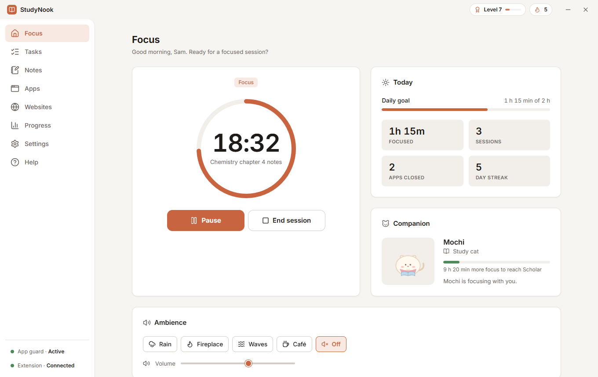
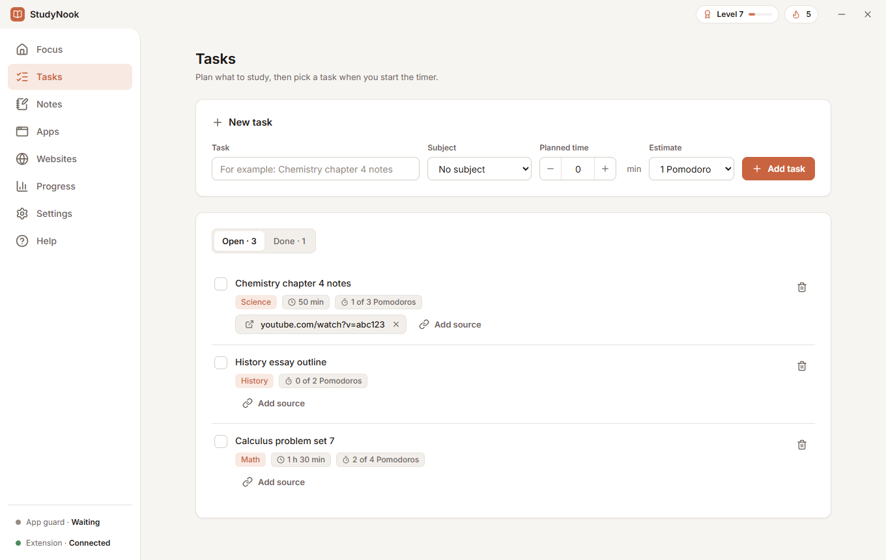
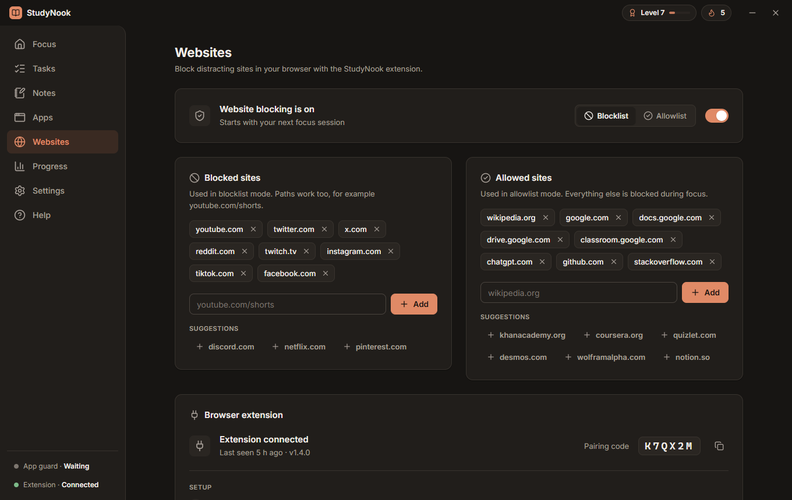
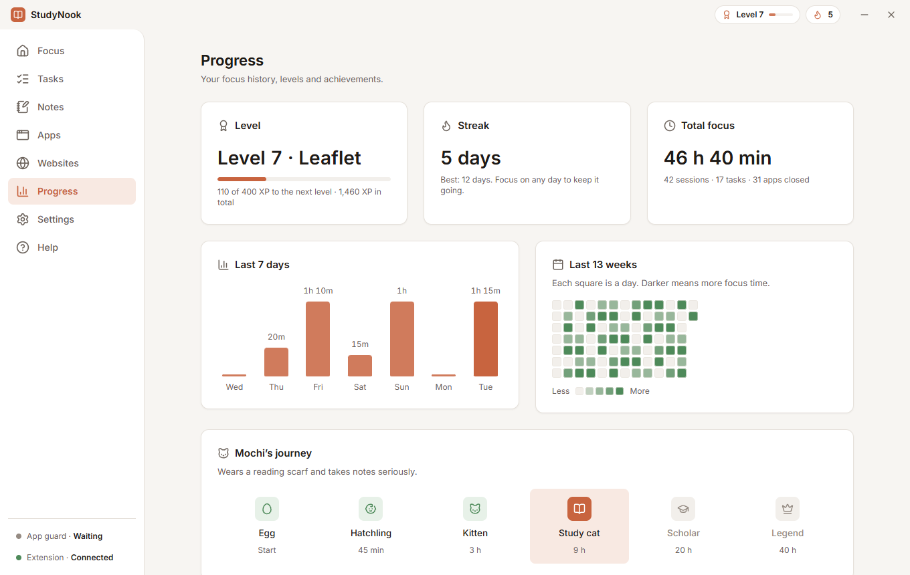
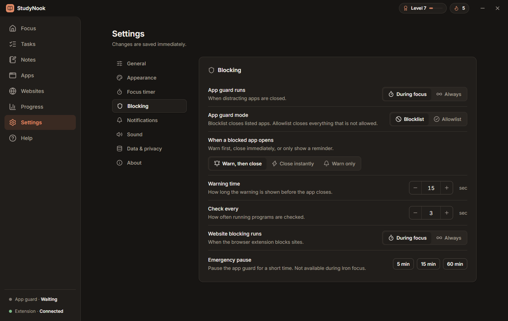
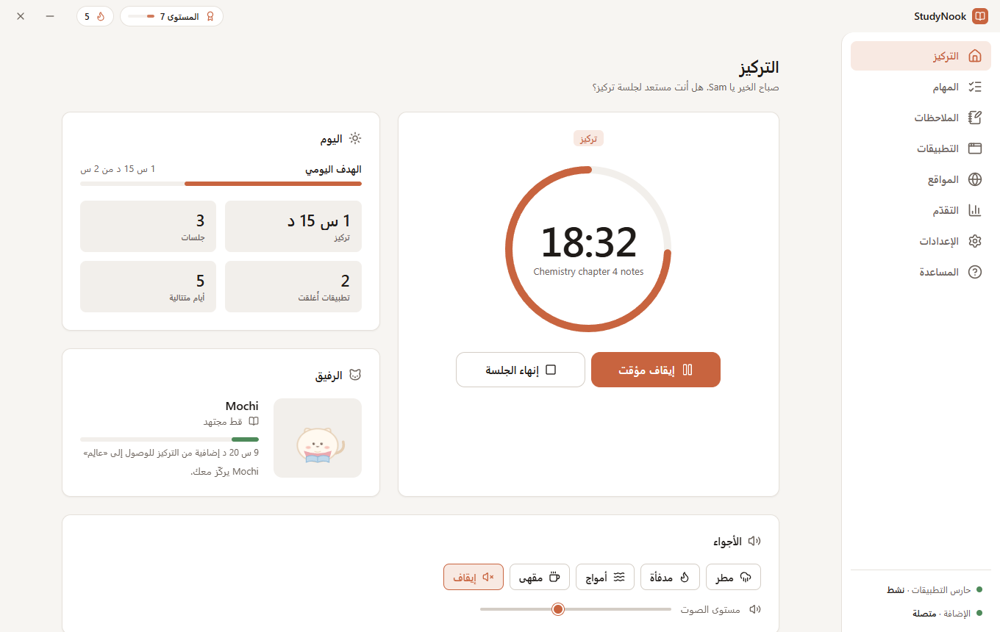
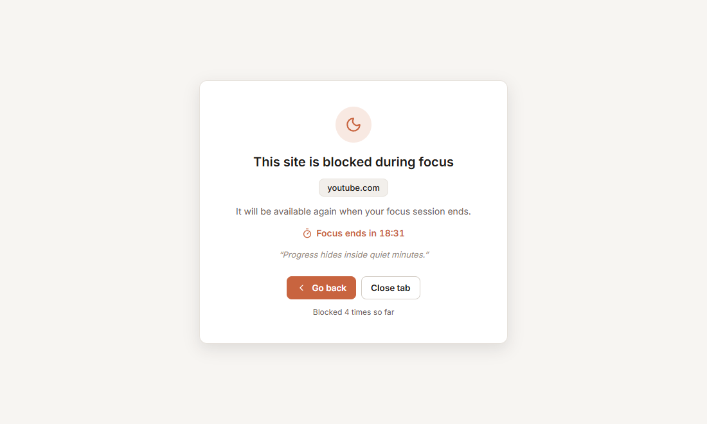

<div align="center">

# StudyNook

**A focus timer that closes distracting apps and blocks distracting websites while you study.**

Pomodoro and free-focus timer · app guard · website blocking · Iron sessions · progress tracking<br>
English · العربية · Français · Español

[Download](https://github.com/Amorgabab/StudyNook/releases) · [Website](https://amorgabab.github.io/StudyNook/) · [Design docs](studynook/docs/UI-REDESIGN-SPEC.md) · [Report an issue](https://github.com/Amorgabab/StudyNook/issues)

[](https://github.com/Amorgabab/StudyNook/actions/workflows/ci.yml)

<picture>
  <source media="(prefers-color-scheme: dark)" srcset="docs/assets/focus-dark.png">
  
</picture>

</div>

## Why StudyNook

Most blockers only cover one thing, and they are easy to switch off in a weak moment. StudyNook covers the programs on your computer **and** the websites in your browser, keeps working when its window is hidden, and has an optional **Iron** mode that makes giving up take effort. It has no account, no cloud and no tracking: everything stays in one folder on your PC.

## Features

| | |
|---|---|
| **Focus timer** | Pomodoro rounds with breaks, or one free-focus block of any length (up to 10 hours). Keeps running from the tray, with an optional always-on-top mini timer. |
| **App guard** | Closes the programs you list while you focus. Blocklist or allowlist mode, with a warning countdown, instant close, or reminder-only. System processes are never touched. |
| **Website blocking** | A Chrome, Edge or Brave extension blocks distracting sites, including single paths such as `youtube.com/shorts`. If StudyNook is closed mid-session the extension keeps blocking until the session would have ended. |
| **Iron sessions** | A promise to yourself: no unpausing the blockers, lists can only grow, ending early needs a 60-second cool-down and a typed sentence, and the switch stays locked for days you choose. If the extension disappears, the browser is closed after about 90 seconds. |
| **Crash recovery** | If the app is closed or killed during a session, a small background helper reopens it and the session continues where it left off. |
| **Tasks and notes** | Tasks with subjects, estimates, planned time and study links. Plain-text notes that save as you type. |
| **Progress** | XP, levels, streaks, a daily focus goal, a 13-week activity map, 24 achievements and a companion that grows with your focus time. |
| **Made for everyone** | Light, dark, system or automatic theme. English, Arabic (full right-to-left layout), French and Spanish. Labelled controls and a visible keyboard focus. |

## Screenshots

<table>
  <tr>
    <td></td>
    <td></td>
  </tr>
  <tr>
    <td></td>
    <td></td>
  </tr>
  <tr>
    <td></td>
    <td></td>
  </tr>
</table>

## Install

StudyNook is built for **Windows**.

**Installer.** Download the latest `StudyNook-Setup-<version>.exe` from [Releases](https://github.com/Amorgabab/StudyNook/releases) and run it.

**From source.** You need [Node.js](https://nodejs.org) (LTS).

```bash
git clone https://github.com/Amorgabab/StudyNook.git
cd StudyNook/studynook
npm install
npm start
```

To build the installer yourself, run `Make-Installer.bat` in the `studynook` folder (it runs `npm install` and `npm run dist`, then opens the installer).

### Connect the browser extension

Website blocking needs the extension, which is bundled with the app:

1. Open Chrome, Edge or Brave and go to `chrome://extensions`.
2. Turn on **Developer mode**.
3. Click **Load unpacked** and choose the `extension` folder (the Websites page shows its exact location).
4. Click the StudyNook extension icon, enter the pairing code shown on the Websites page, and click **Pair**.

## How it works

```
 StudyNook (Electron)  ──────────►  closes distracting programs (app guard)
   timer · data · tray
        │   127.0.0.1:47470 (token + pairing code, this computer only)
        ▼
 Browser extension (Manifest V3)  ─►  redirects blocked sites to a calm page
```

Everything is stored as readable JSON in `studynook/data/` (or your user-data folder when installed): settings, tasks, notes, progress, a daily backup (the last seven are kept) and `lifecycle.log`. The extension talks only to the app on your own computer. See the in-app **Help** for details on every feature.

## Good to know

- Browsers never let an app stop you from removing or turning off an extension. StudyNook warns you if the extension stops responding during a focus, and in an Iron session it closes the browser. It cannot do more than that.
- The app closes programs you choose with a forced close, so save your work before a focus session.
- Website blocking works in Chrome-family browsers only (Chrome, Edge, Brave).

## Development

Run everything from the `studynook` folder.

| Command | What it does |
|---|---|
| `npm start` | Run the app from source |
| `npm test` | Unit tests (plain Node, no Electron needed) |
| `npm run lint` | ESLint |
| `npm run smoke` | Boot the engine and the extension bridge in plain Node and talk to it like the extension does |
| `npm run dist` | Build the Windows installer into `dist-installer/` |

Pushes to `main` and pull requests run lint and the tests on Windows ([workflow](.github/workflows/ci.yml)).

**Project layout**

| Path | Contents |
|---|---|
| `studynook/app/main/` | Electron main process: data store, timer engine, app guard, extension bridge, watchdog, IPC |
| `studynook/app/ui/` | The windows: plain HTML, CSS and JavaScript (no bundler), pages, help articles |
| `studynook/app/shared/` | Pure modules shared by main and the windows: progress, Iron rules, themes, translations, icons |
| `studynook/extension/` | The Manifest V3 browser extension |
| `studynook/tests/` | Unit and integration tests |
| `studynook/docs/` | Design specification and engineering notes |
| `docs/` | This project's website (GitHub Pages) |

Contributor notes for working in the code, including the rules that are easy to break, are in [`CLAUDE.md`](CLAUDE.md). The design system is described in [`studynook/docs/UI-REDESIGN-SPEC.md`](studynook/docs/UI-REDESIGN-SPEC.md).

## License

StudyNook is **not open source**. You may download it, run it for your own use and read the code, but you may not share, publish or redistribute it, or distribute modified versions. See [LICENSE](LICENSE) for the exact terms. To ask for permission to do something it does not allow, [open an issue](https://github.com/Amorgabab/StudyNook/issues).

Third-party components keep their own licenses: the Inter typeface (SIL OFL 1.1), Lucide icons (ISC) and Electron (MIT).
